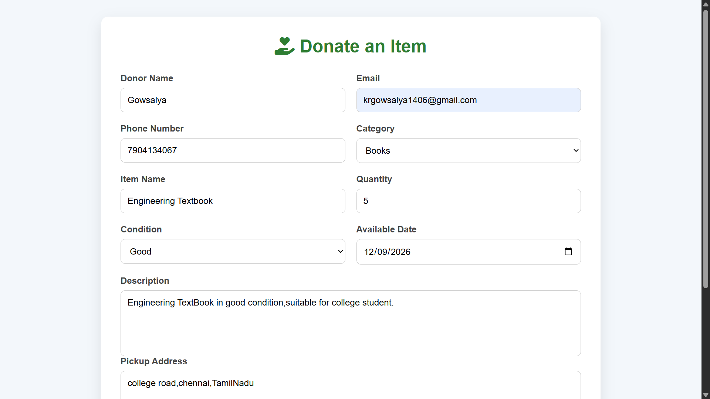

# 💝 DonorSync
### One Item. One Connection. Endless Possibilities.

<p align="center">
  
</p>

<p align="center">
  
</p>

<p align="center">
  
  
  
  
</p>

<p align="center">
  <b>♻️ REUSE RESOURCES • ❤️ SHARE KINDNESS • 🌍 CHANGE LIVES</b>
</p>

---

## 🌐 EXPERIENCE DONORSYNC LIVE

<p align="center">
  <b>Don't just read about giving. Experience it.</b>
  <br/>
  Explore the DonorSync platform and discover how technology makes generosity easier.
  <br/><br/>
  <a href="YOUR_LIVE_DEMO_URL">
    
  </a>
  &nbsp;
  <a href="YOUR_GITHUB_REPOSITORY_URL">
    
  </a>
</p>

<p align="center">
  <i>Explore. Connect. Donate. Make an Impact. 💜</i>
</p>

---

## ✦ THE STORY BEHIND THE PLATFORM

**Somewhere, something unused is exactly what someone else needs.**

A book sitting untouched. Clothes waiting in a cupboard. Furniture taking up space. Useful resources often become waste simply because the right people never find each other.

That's where **DonorSync** comes in.

DonorSync is a digital donation management ecosystem built to connect people who have resources to share with people and organizations that need them.

Through organized donation management, resource discovery, community connections, and donation tracking, the platform transforms ordinary giving into a meaningful digital experience.

> We don't just move items. We connect possibilities.

---

## ◈ THE CIRCLE OF GIVING

<p align="center">
  <b>Every meaningful donation begins with a simple decision.</b>
</p>

```text
           💜 A THOUGHT TO GIVE
                    |
                    ▼
             👤 THE DONOR
                    |
                    ▼
           🎁 RESOURCE SHARING
                    |
                    ▼
              🔍 DISCOVERY
                    |
                    ▼
              🤝 CONNECTION
                    |
                    ▼
               📦 DELIVERY
                    |
                    ▼
             ❤️ NEW BEGINNING
                    |
                    ▼
           🌱 COMMUNITY IMPACT
```

**One resource. A new purpose. A better tomorrow.**

---

## ✨ INSIDE THE DONORSYNC ECOSYSTEM

Rather than treating donations as individual transactions, DonorSync organizes the experience into connected modules.

### 01 — 💜 The Identity Space
*Your giving journey starts here.*

- Donor Registration
- User Login
- Personal Profile
- Account Management
- Password Management
- Personalized Dashboard

### 02 — 🎁 The Giving Studio
*Turn unused resources into useful opportunities.*

- Interactive Donation Form
- Multiple Item Categories
- Item Image Upload
- Quantity and Description
- Pickup Location
- Contact Details
- Donation Submission
- Digital Confirmation

### 03 — 🔎 The Discovery Hub
*Find resources. Discover possibilities.*

- Available Donation Listings
- Search and Filters
- Category-Based Discovery
- Location-Based Listings
- Saved Donations
- Item Details
- Donor–Receiver Connection

### 04 — 🤝 The Connection Network
*Technology connects generosity with genuine needs.*

- NGO Support
- Community Donation Activities
- Resource Requests
- Donation Events
- Volunteer Opportunities
- Community Engagement

### 05 — 📊 The Impact Observatory
*Every contribution tells a story.*

- Donation Statistics
- Activity Overview
- Donation History
- Contribution Records
- Community Impact Metrics
- Visual Analytics

### 06 — 🔔 The Communication Center
*Stay connected at every step.*

- Donation Notifications
- Status Updates
- Request Alerts
- Event Announcements
- Email Confirmation
- Help and Support

### 07 — ⚙️ The Personal Experience
*Designed around the people who give.*

- Responsive Interface
- Dark and Light Themes
- Interactive Components
- Form Validation
- Success Notifications
- Mobile-Friendly Experience

---

## 🚀 THE DONORSYNC DIFFERENCE

### Not Just a Donation Platform. A Connected Giving Experience.

| Signature Concept | Purpose |
|---|---|
| 🆘 Emergency Give Mode | Highlights urgent donation needs |
| 🧠 Smart Resource Matcher | Helps connect items with suitable requirements |
| 🎫 Donation Passport | Maintains a digital record of an item's donation journey |
| 🌱 Eco Impact Calculator | Illustrates the environmental value of reuse |
| 💜 Kindness Score | Recognizes donor contributions |
| 🗺️ Community Need Map | Visualizes areas requiring support |
| 📦 Resource Fusion | Groups similar resources to fulfill community requirements |
| 💌 Gratitude Wall | Shares appreciation and positive stories |
| 🏆 Impact Milestones | Celebrates donation achievements |
| 🔄 Journey Tracker | Follows donation progress from listing to delivery |

---

## ♻️ THE SECOND-LIFE JOURNEY

<p align="center">
  
  
  
  
</p>

A donation should never feel like an item disappearing into a system.

DonorSync aims to make its journey more transparent:

- **Listed:** The donor shares an available resource.
- **Matched:** A relevant requirement is identified.
- **Picked Up:** Collection is coordinated.
- **Delivered:** The resource reaches its intended destination.

*The journey ends. The impact continues.*

---

## 🌍 IMPACT BEYOND THE SCREEN

```text
       ┌──────────────────────────┐
       │      SOCIAL IMPACT       │
       │   Helping communities    │
       └────────────┬─────────────┘
                    │
       ┌────────────▼─────────────┐
       │   ENVIRONMENTAL IMPACT   │
       │     Reducing waste       │
       └────────────┬─────────────┘
                    │
       ┌────────────▼─────────────┐
       │      RESOURCE IMPACT     │
       │  Extending item lifecycles│
       └────────────┬─────────────┘
                    │
       ┌────────────▼─────────────┐
       │      HUMAN IMPACT        │
       │   Encouraging kindness   │
       └──────────────────────────┘
```

Our vision is to encourage a culture where sharing becomes easier, resources find new purposes, and communities become more connected.

---

## 🖥️ THE DONORSYNC EXPERIENCE

### A visual journey through the platform.

**01. Welcome Experience**


**02. Create Your Identity**


**03. Your Giving Dashboard**


**04. The Giving Studio**



**05. Discover Available Resources**


**06. Stay Informed**


**07. Community Impact**


**08. Community Events**


**09. Personal Settings**


**10. Help and Support**


---

## ⚡ TECHNOLOGY THAT POWERS THE IDEA

<p align="center">
  
</p>

| Technology | Role in DonorSync |
|---|---|
| HTML5 | Structure and content |
| CSS3 | Visual design and responsive layouts |
| JavaScript | Dynamic interactions and validation |
| PHP | Backend processing |
| MySQL | Structured data management |
| Git | Version control |
| GitHub | Repository and collaboration |
| VS Code | Development environment |

---

## 📂 PROJECT ARCHITECTURE

```text
DonorSync/
│
├── 📄 index.html
├── 📄 login.html
├── 📄 register.html
├── 📄 dashboard.html
├── 📄 donate.html
├── 📄 available.html
├── 📄 mydonation.html
├── 📄 notification.html
├── 📄 accountsetting.html
├── 📄 event.html
├── 📄 helpandsupport.html
├── 📄 communityimpact.html
├── 📄 scan.html
├── 📄 success.html
├── 📄 upgrade.html
│
├── 🎨 css/
│   ├── dashboard.css
│   ├── donate.css
│   └── available.css
│
├── ⚙️ js/
│   ├── dashboard.js
│   ├── donate.js
│   └── available.js
│
├── 🐘 php/
│   └── backend files
│
├── 🗄️ database/
│   └── database.sql
│
├── 🖼️ image/
│   ├── donatesmarter.png
│   ├── createaccount.png
│   ├── dashboard.png
│   ├── donateitem.png
│   ├── availableitem.png
│   ├── notification.png
│   ├── impact.png
│   ├── event.png
│   ├── account.png
│   └── help.png
│
└── 📄 README.md
```

*Update the folder structure to reflect the actual files in your repository.*

---

## 🔮 THE INNOVATION LAB

The next chapter of DonorSync is about making donations smarter, more accessible, and more transparent.

- [ ] AI-Based Donation Recommendations
- [ ] Intelligent Donor–Receiver Matching
- [ ] Emergency Donation Network
- [ ] Interactive Community Need Map
- [ ] Digital Donation Passport
- [ ] Environmental Impact Calculator
- [ ] QR-Based Donation Verification
- [ ] Automated Email and SMS Alerts
- [ ] Verified NGO Network
- [ ] Pickup and Delivery Coordination
- [ ] Real-Time Communication
- [ ] Multilingual Support
- [ ] Mobile Application
- [ ] Advanced Donation Analytics
- [ ] Community Campaign Management

---

## 💭 A NOTE FROM THE CREATOR

I believe technology becomes truly meaningful when it solves problems that matter in everyday life.

DonorSync is built around a simple idea: useful resources should not go to waste when someone else could benefit from them
