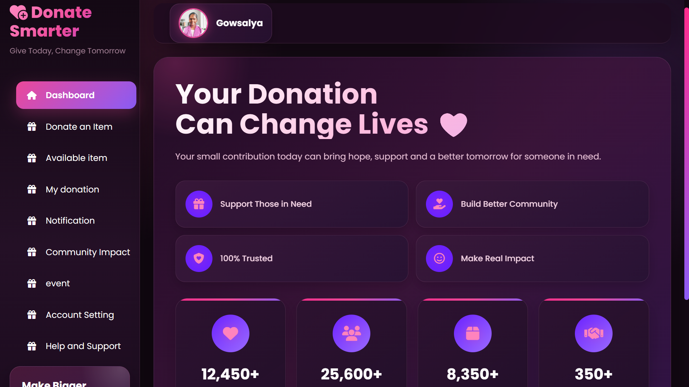
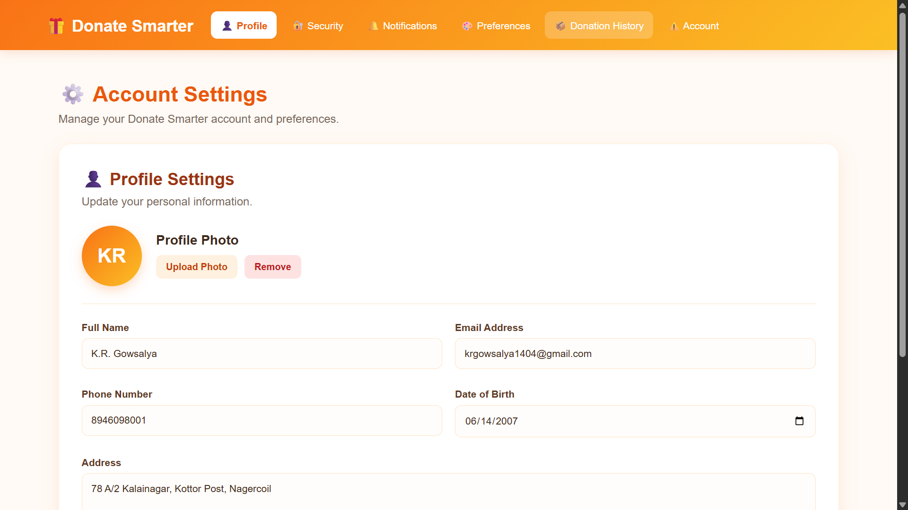

# 💜 DonorSync — Give. Connect. Transform.

<p align="center">
  
</p>

<p align="center">
  
</p>

<p align="center">
  <b>A smarter way to give. A better way to live.</b>
  <br/>
  Connecting people, resources and communities through meaningful donations.
</p>

<p align="center">
  <a href="YOUR_LIVE_DEMO_URL">✦ LIVE DEMO</a> &nbsp; • &nbsp;
  <a href="YOUR_GITHUB_REPOSITORY_URL">⌘ SOURCE CODE</a>
</p>

<p align="center">
  
  
</p>

<p align="center">
  
</p>

---

<h2 align="center">✦ THE POWER OF SHARING ✦</h2>

<p align="center">
  What is unused for one person can become valuable to another.
  <br/>
  DonorSync brings that possibility into one digital platform.
</p>

<br/>

<table>
<tr>
<td align="center" width="33%">
  <h1>🎁</h1>
  <b>GIVE</b>
  <br/>
  <sub>Share useful resources with others.</sub>
</td>
<td align="center" width="33%">
  <h1>🤝</h1>
  <b>CONNECT</b>
  <br/>
  <sub>Bring donors and people together.</sub>
</td>
<td align="center" width="33%">
  <h1>🌱</h1>
  <b>TRANSFORM</b>
  <br/>
  <sub>Make sharing a meaningful habit.</sub>
</td>
</tr>
</table>

---

<h2 align="center">✧ EXPLORE THE EXPERIENCE ✧</h2>

<table>
<tr>
<td width="50%">
  <h3>01 / Personal Dashboard</h3>
  
  <sub>Your donation activity, organized in one place.</sub>
</td>
<td width="50%">
  <h3>02 / Donation Studio</h3>
  
  <sub>Turn useful items into opportunities to help.</sub>
</td>
</tr>
<tr>
<td width="50%">
  <h3>03 / Discovery Space</h3>
  
  <sub>Explore available donated resources.</sub>
</td>
<td width="50%">
  <h3>04 / Community Impact</h3>
  
  <sub>Explore the difference that sharing can make.</sub>
</td>
</tr>
<tr>
<td width="50%">
  <h3>05 / Notifications</h3>
  
  <sub>Keep up with platform updates.</sub>
</td>
<td width="50%">
  <h3>06 / Community Events</h3>
  
  <sub>Discover opportunities to participate.</sub>
</td>
</tr>
</table>

<p align="center">
  
  
</p>

<p align="center"><sub>Account creation · Profile management</sub></p>

---

<h2 align="center">⚡ BUILT TO MAKE GIVING EASIER</h2>

<table>
<tr>
<td width="50%" valign="top">

### 🔐 Identity & Access
- User registration
- Login functionality
- Account management

### 🎁 Donation Management
- Submit donation details
- Add item information
- Upload item images

### 🔎 Resource Discovery
- Browse available items
- View donation information
- Explore resources

</td>
<td width="50%" valign="top">

### 📊 Personal Dashboard
- Donation overview
- Activity information
- Organized user experience

### 🔔 Stay Connected
- Notifications
- Community events
- Help and support

### 🌍 Community Impact
- Impact information
- Resource-sharing awareness
- Sustainable giving

</td>
</tr>
</table>

---

<h2 align="center">🔄 THE DONATION JOURNEY</h2>

<p align="center">
  <b>DISCOVER</b> &nbsp; → &nbsp;
  <b>DONATE</b> &nbsp; → &nbsp;
  <b>CONNECT</b> &nbsp; → &nbsp;
  <b>MAKE AN IMPACT</b>
</p>

---

<h2 align="center">🧩 THE TECHNOLOGY BEHIND IT</h2>

<p align="center">
  
</p>

| Technology | Role |
|:---|:---|
| HTML5 | Structure and content |
| CSS3 | Styling and responsive design |
| JavaScript | Frontend interactivity |
| PHP | Backend development |
| MySQL | Data management |

---

<h2 align="center">📂 PROJECT ARCHITECTURE</h2>

```text
DonorSync/
│
├── index.html
├── login.html
├── register.html
├── dashboard.html
├── donate.html
├── available.html
├── mydonation.html
├── notification.html
├── communityimpact.html
├── event.html
├── accountsetting.html
├── helpandsupport.html
│
├── css/
├── js/
├── image/
│
└── README.md
```

---

<h2 align="center">🚀 RUN LOCALLY</h2>

**Requirements:** XAMPP · PHP · MySQL · Web Browser

```bash
# Clone the repository
git clone YOUR_GITHUB_REPOSITORY_URL
```

1. Move the project into the XAMPP `htdocs` folder.
2. Start Apache and MySQL.
3. Create and configure the required database.
4. Update the PHP database connection settings.
5. Open the application:

```text
http://localhost/DonorSync/
```

---

<h2 align="center">🔭 WHAT'S NEXT?</h2>

| Upcoming Feature | Vision |
|:---|:---|
| Smart Matching | Connect resources with relevant needs |
| NGO Integration | Expand community partnerships |
| Location Discovery | Find nearby donation opportunities |
| Live Tracking | Follow donation progress |
| Impact Analytics | Understand community contributions |

---

<h2 align="center">👩🏻‍💻 THE CREATOR</h2>

<p align="center">
  
  <br/><br/>
  <b>Computer Science & Engineering Student</b>
  <br/>
  Exploring Full Stack Development, Creative Technology & Real-World Solutions.
  <br/><br/>
  <a href="https://github.com/krgowsalya1406-gif">
    
  </a>
</p>

---

<p align="center">
  
</p>

<p align="center">
  <b>💜 DonorSync</b>
  <br/>
  <i>Because the best things in life are better when shared.</i>
</p>
