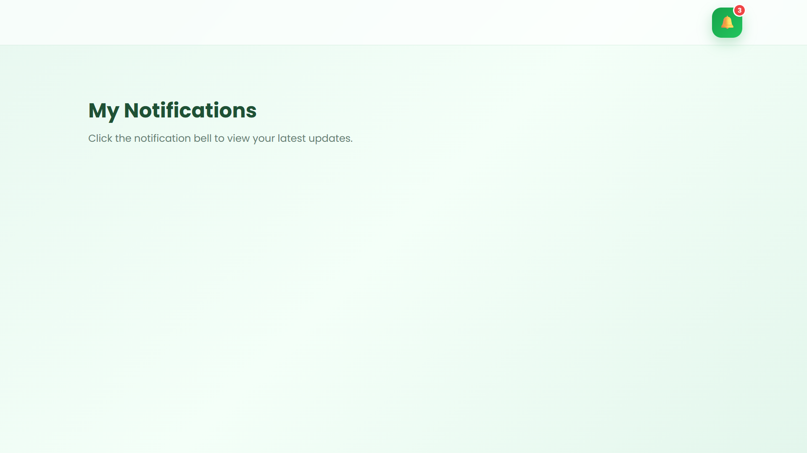
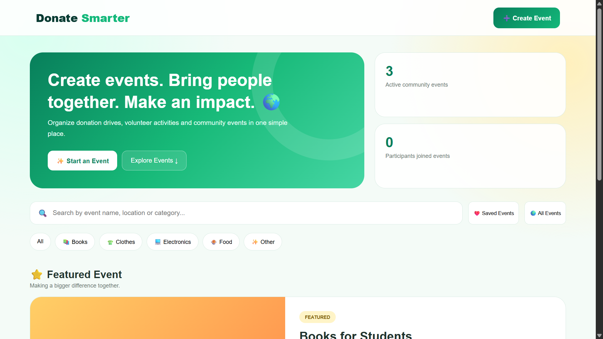

# 💝 DonorSync
### Give More. Waste Less. Make Every Gift Matter.

<p align="center">
  
</p>

<p align="center">
  A donation management platform designed to make giving simpler, resource sharing smarter, and community impact stronger.
</p>

<p align="center">
  <a href="YOUR_LIVE_DEMO_URL"><strong>🌐 Live Demo</strong></a> ·
  <a href="YOUR_GITHUB_REPOSITORY_URL"><strong>💻 Source Code</strong></a>
</p>

<p align="center">
  
  
  
  
  
</p>

---

## ✨ The Idea Behind DonorSync

Every day, useful items go unused while someone nearby may need them.

**DonorSync aims to bridge that gap.**

It provides a digital space where people can share useful resources, manage donations, discover available items, and contribute towards a more supportive community.

The goal is simple: turn unused resources into meaningful opportunities.

## 🚀 Platform Highlights

| Feature | Description |
|---|---|
| 🔐 User Authentication | Account registration and login |
| 🎁 Donation Management | Submit and manage donation details |
| 📦 Item Discovery | Explore available donated items |
| 📊 Personal Dashboard | View donation activity and platform information |
| 🔔 Notifications | Stay informed about relevant updates |
| 🌱 Community Impact | Explore the positive impact of resource sharing |
| 📅 Events | Discover community activities and events |
| ⚙️ Account Settings | Manage personal account information |
| 💬 Help & Support | Access assistance and support information |

## 🖥️ A Look Inside DonorSync

<p align="center">
  <strong>01 · Platform Preview</strong>
</p>

<p align="center">
  
</p>

<p align="center">
  <strong>02 · Create Your Account</strong>
</p>

<p align="center">
  
</p>

<p align="center">
  <strong>03 · Your Dashboard</strong>
</p>

<p align="center">
  
</p>

<p align="center">
  <strong>04 · Share Something Useful</strong>
</p>

<p align="center">
  
</p>

<p align="center">
  <strong>05 · Discover Available Items</strong>
</p>

<p align="center">
  
</p>

<p align="center">
  <strong>06 · Stay Connected</strong>
</p>

<p align="center">
  
</p>

<p align="center">
  <strong>07 · Measure Community Impact</strong>
</p>

<p align="center">
  
</p>

<p align="center">
  <strong>08 · More Ways to Participate</strong>
</p>

<p align="center">
  
</p>

<p align="center">
  
  
</p>

## 🔄 How It Works

```text
       CREATE AN ACCOUNT
               |
               ▼
        EXPLORE THE PLATFORM
               |
               ▼
          ADD A DONATION
               |
               ▼
       DISCOVER AVAILABLE ITEMS
               |
               ▼
       CONNECT THROUGH GIVING
               |
               ▼
       CREATE COMMUNITY IMPACT
```

## 🛠️ Technology Stack

| Technology | Purpose |
|---|---|
| HTML5 | Page structure |
| CSS3 | Styling and responsive layouts |
| JavaScript | Interactive functionality |
| PHP | Server-side functionality |
| MySQL | Database management |

## 📁 Project Structure

```text
DonorSync/
│
├── index.html
├── login.html
├── register.html
├── dashboard.html
├── donate.html
├── available.html
├── mydonation.html
├── notification.html
├── communityimpact.html
├── event.html
├── accountsetting.html
├── helpandsupport.html
├── scan.html
├── success.html
├── upgrade.html
│
├── css/
│   ├── dashboard.css
│   ├── donate.css
│   └── available.css
│
├── js/
│   ├── dashboard.js
│   ├── donate.js
│   └── available.js
│
├── image/
│   ├── donatesmarter.png
│   ├── createaccount.png
│   ├── dashboard.png
│   ├── donateitem.png
│   ├── availableitem.png
│   ├── notification.png
│   ├── impact.png
│   ├── event.png
│   ├── account.png
│   └── help.png
│
└── README.md
```

*Adjust the folder structure above to match your actual repository.*

## ⚙️ Getting Started

### Prerequisites

- Visual Studio Code
- XAMPP
- PHP
- MySQL
- Web browser

### Installation

**1. Clone the repository**

```bash
git clone YOUR_GITHUB_REPOSITORY_URL
```

**2. Move the project**

Place the project folder inside the XAMPP `htdocs` directory.

**3. Start XAMPP**

Start Apache and MySQL.

**4. Configure the database**

- Open phpMyAdmin.
- Create the required database.
- Import your project SQL file, if available.
- Update the database connection settings in your PHP configuration.

**5. Run the project**

Open your browser and visit:

```text
http://localhost/DonorSync/
```

## 🌟 What Makes DonorSync Meaningful?

- Encourages responsible reuse of useful resources.
- Makes donation information easier to organize.
- Creates opportunities for people to help one another.
- Brings community participation into one platform.
- Promotes a culture of sharing instead of wasting.

## 🔮 Future Possibilities

- Intelligent donation recommendations.
- Location-based donation discovery.
- NGO and volunteer integration.
- Real-time donation status updates.
- Advanced community impact analytics.
- Automated donation reminders.
- Enhanced accessibility and multilingual support.

## 👩‍💻 Developed By

<p align="center">
  <strong>Gowsalya K.R</strong><br/>
  Computer Science and Engineering Student<br/>
  Aspiring Full Stack Developer
</p>

<p align="center">
  <a href="https://github.com/krgowsalya1406-gif">
    
  </a>
</p>

---

<p align="center">
  <strong>💜 DonorSync</strong>
  <br/>
  Not everything valuable needs to be bought. Sometimes, it just needs to be shared.
  <br/><br/>
  <em>Give with Purpose. Share with Care. Make an Impact.</em>
</p>
