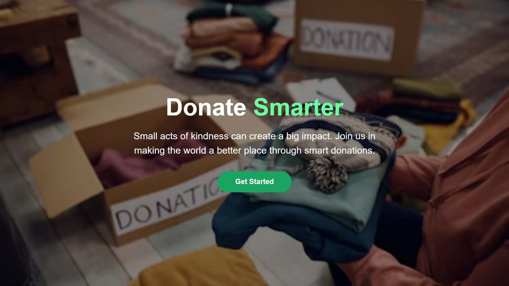
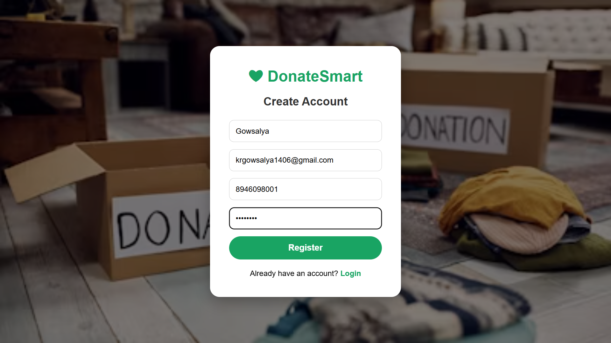
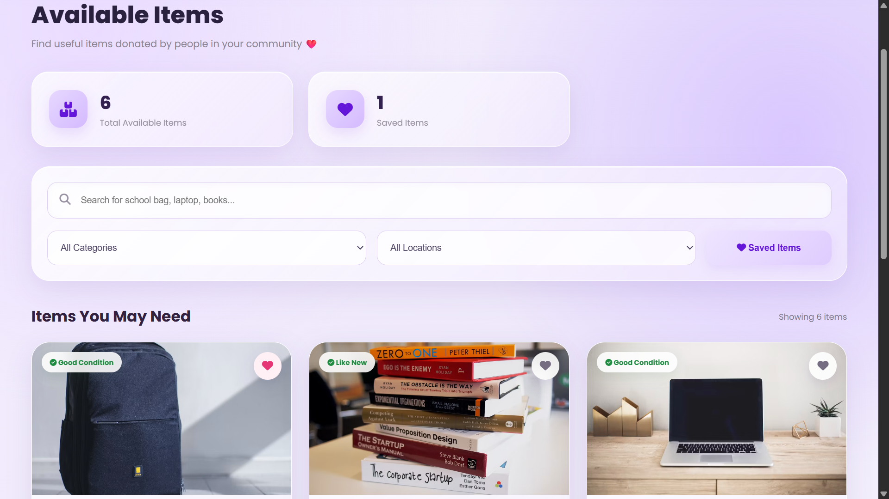

# 💜 DonorSync — Smart Donation & Resource Sharing Platform

<div align="center">


### ✨ Share What You Can. Change What You Can.

A modern donation management platform that brings donors, useful resources, and communities together through meaningful sharing.

<br/>


<br/><br/>


</div>

---

## 🌷 About DonorSync

**What if something you no longer need could become something someone else truly needs?**

That's the idea behind DonorSync.

DonorSync is a web-based donation management platform designed to simplify the process of sharing useful items. It provides a centralized space where users can manage donations, explore available resources, view updates, and participate in community-focused activities.

Instead of letting valuable resources go unused, DonorSync encourages people to give them a second life.

### 🎯 Our Mission

To make resource sharing more accessible, organized, and meaningful by connecting people through the power of giving.

---

## ✨ Explore the Platform

| Module | What You Can Do |
|:---|:---|
| 🔐 Account Access | Register, log in and manage your account |
| 🏠 Dashboard | Access your donation activities |
| 🎁 Donate Items | Submit donation information and item details |
| 🔎 Available Items | Explore resources available for donation |
| 📋 My Donations | View and manage your donation records |
| 🔔 Notifications | Stay updated with platform notifications |
| 🌱 Community Impact | Explore the impact of sharing |
| 📅 Events | Discover community activities |
| ⚙️ Account Settings | Manage your personal information |
| 💬 Help & Support | Find assistance and support information |

---
### 🌐 LIVE DEMO

<a href="YOUR_LIVE_DEMO_URL">
  
</a>

### 💻 SOURCE CODE

<a href="YOUR_GITHUB_REPOSITORY_URL">
  
</a>


## 🖼️ A Visual Tour of DonorSync

### 01. Welcome to DonorSync

The starting point of a platform built around sharing and community support.

<p align="center">

</p>

### 02. Create Your Account

A simple registration experience to get started with the platform.

<p align="center">

</p>

### 03. Your Personal Dashboard

A centralized space to access important platform sections and donation activities.

<p align="center">

</p>

### 04. Make a Donation

Share useful items by providing donation details and relevant information.

<p align="center">

</p>

### 05. Discover Available Resources

Explore items shared through the donation platform.

<p align="center">

</p>

### 06. Never Miss an Update

Stay informed through the notification section.

<p align="center">

</p>

### 07. Every Contribution Matters

Explore the community impact experience.

<p align="center">

</p>

### 08. Be Part of the Community

Discover events and manage your personal account.

<p align="center">

</p>

<p align="center">


</p>

---

## 💫 The DonorSync Experience

<div align="center">

| 🎁 GIVE | 🔍 DISCOVER | 💜 CONNECT |
|:---:|:---:|:---:|
| Share useful resources | Explore available items | Encourage meaningful giving |

| 📊 MANAGE | 🔔 STAY UPDATED | 🌱 MAKE AN IMPACT |
|:---:|:---:|:---:|
| Organize donation activity | View notifications | Support resource reuse |

</div>

---

## 🛠️ Technology Stack

<div align="center">

### Built with technologies that bring ideas to life


</div>

| Technology | Role in the Project |
|:---|:---|
| HTML5 | Application structure |
| CSS3 | Styling, layouts and responsive design |
| JavaScript | Interactive functionality |


---

## 🔄 How DonorSync Works

<div align="center">

```text
          START YOUR JOURNEY
                  |
                  ▼
            CREATE ACCOUNT
                  |
                  ▼
           EXPLORE DASHBOARD
                  |
                  ▼
           SHARE A DONATION
                  |
                  ▼
          DISCOVER RESOURCES
                  |
                  ▼
          CONNECT THROUGH GIVING
                  |
                  ▼
           CREATE AN IMPACT
```

**A simple journey. A meaningful purpose.**

</div>

---

## 📁 Project Structure

```text
DonorSync/
│
├── index.html
├── login.html
├── register.html
├── dashboard.html
├── donate.html
├── available.html
├── mydonation.html
├── notification.html
├── communityimpact.html
├── event.html
├── accountsetting.html
├── helpandsupport.html
├── scan.html
├── success.html
├── upgrade.html
│
├── css/
│   ├── dashboard.css
│   ├── donate.css
│   └── available.css
│
├── js/
│   ├── dashboard.js
│   ├── donate.js
│   └── available.js
│
├── image/
│   ├── donatesmarter.png
│   ├── createaccount.png
│   ├── dashboard.png
│   ├── donateitem.png
│   ├── availableitem.png
│   ├── notification.png
│   ├── impact.png
│   ├── event.png
│   ├── account.png
│   └── help.png
│
└── README.md
```

*Update this tree if your actual folders or filenames differ.*

---

## 🚀 Run DonorSync Locally

### Prerequisites

- Visual Studio Code
- XAMPP
- PHP
- MySQL, if used by your application
- Web browser

### Installation Steps

**1. Clone the repository**

```bash
git clone YOUR_GITHUB_REPOSITORY_URL
```

**2. Move the project**

Place the `DonorSync` folder inside the XAMPP `htdocs` directory.

**3. Start the server**

Open XAMPP Control Panel and start Apache and MySQL if required.

**4. Configure the database**

Create the project database, import the provided SQL file if available, and configure the PHP database connection.

**5. Launch the application**

Open your browser and visit:

```text
http://localhost/DonorSync/
```

---

## 🔮 What's Coming Next?

The platform has opportunities to grow with additional capabilities.

- 🤖 Smart donation recommendations
- 📍 Location-based resource discovery
- 🏢 NGO and volunteer connections
- 🔔 Automated donation notifications
- 📈 Advanced community impact analytics
- 📦 Donation progress tracking
- 🌐 Multilingual accessibility
- 📱 Mobile-friendly application experience

---

## 🎓 What I Learned

Working on DonorSync helped me gain practical experience in:

- Developing multi-page web applications.
- Building responsive interfaces using HTML and CSS.
- Implementing interactive features using JavaScript.
- Understanding PHP-based web development.
- Working with donation workflows and user interfaces.
- Organizing a project into reusable files and modules.
- Designing a platform around a real-world problem.

---

## 👩‍💻 Meet the Developer

<div align="center">


**Computer Science & Engineering Student**

Frontend Developer | Full Stack Development Enthusiast | Tech Explorer

Building meaningful digital experiences through creativity and code.

<br/>

<a href="https://github.com/krgowsalya1406-gif">

</a>

</div>

---

<div align="center">

### 💜 A LITTLE GIVING CAN CREATE A BIG DIFFERENCE.

**DonorSync — Give More. Waste Less. Share More.**

*Every useful item deserves a second chance.*


</div>
