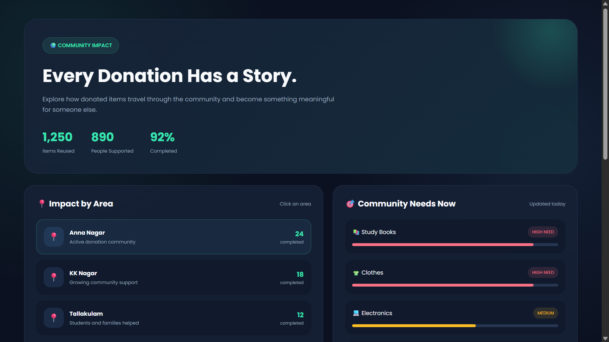
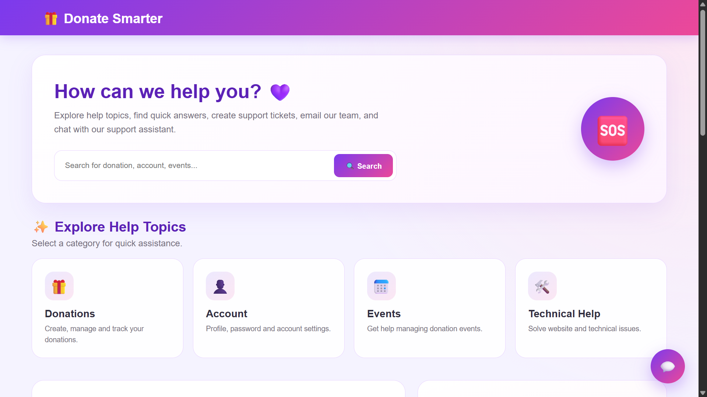

# 💝 DonorSync
### Every Donation Deserves a Destination.

<p align="center">
  
</p>

<p align="center">
  
</p>

<p align="center">
  
  
  
  
</p>

<p align="center">
  <b>Give • Connect • Reuse • Transform</b>
</p>

---

## 🌍 About DonorSync

What if the things we no longer need could become someone's greatest necessity?

**DonorSync** is a modern donation management platform designed to connect donors, receivers, and NGOs through a simple and organized digital ecosystem.

Built using HTML, CSS, JavaScript, and PHP, DonorSync helps people donate useful items, discover available resources, manage donation activities, and create meaningful community impact.

Instead of allowing reusable resources to become waste, DonorSync gives them another opportunity to make a difference.

**Our philosophy: Every unused item has the potential to change someone's life.**

---

## 💫 The Idea Behind DonorSync

Traditional donation processes can be difficult to organize, track, and manage.

DonorSync addresses these challenges through a connected platform that brings together:

- People willing to donate.
- Individuals looking for essential resources.
- NGOs supporting communities.
- Donation activities and community events.
- Digital records and donation progress.

Our goal is not simply to collect donations. It is to make every contribution meaningful, traceable, and accessible.

---

## ✨ Core Features

### 👤 01. User & Identity Management
- Donor Registration and Login
- User Profile Management
- Secure Account Settings
- Password Management
- Contact Information
- Personalized Dashboard

### 🎁 02. Smart Donation Management
- Interactive Donation Submission
- Multiple Donation Categories
- Item Description and Quantity
- Image Upload
- Pickup Location Details
- Donation History
- Donation Status Tracking
- Digital Donation Records

### 🔍 03. Resource Discovery
- Explore Available Donations
- Search Items
- Category-Based Filtering
- Location-Based Discovery
- Save Favorite Donations
- Donation Details
- Donor–Receiver Connection

### 🤝 04. Community Connection
- NGO Support
- Community Donation Activities
- Donation Events
- Volunteer Opportunities
- Community Impact Overview
- Gratitude and Appreciation

### 📊 05. Analytics & Dashboard
- Donation Statistics
- Donation Activity Overview
- Community Impact Metrics
- Donation Progress
- Personal Contribution History
- Visual Dashboard Analytics

### 🔔 06. Notifications & Communication
- Donation Notifications
- Status Updates
- Request Alerts
- Event Notifications
- Email Confirmation
- Help and Support

### 🎨 07. User Experience
- Premium Responsive Interface
- Dark and Light Mode
- Interactive Components
- Form Validation
- Success Notifications
- Mobile-Friendly Design

---

## 🚀 DonorSync Signature Innovations

These are the concepts that give DonorSync its own identity.

| Innovation | Description |
|---|---|
| 🆘 Emergency Give | Prioritizes urgent community donation requirements |
| 🧠 Smart Match | Connects donation items with relevant receiver needs |
| 🎫 Donation Passport | Digital identity and journey record for each donation |
| 🌱 Eco Impact | Illustrates the environmental value of reused items |
| 💜 Kindness Score | Recognizes meaningful donor contributions |
| 🗺️ Community Need Map | Visualizes areas requiring donation support |
| 📦 Resource Fusion | Combines similar resources to fulfill larger needs |
| 💌 Gratitude Wall | Shares appreciation and positive donation stories |
| 🏆 Impact Badges | Recognizes community contribution milestones |
| 🔄 Journey Tracker | Tracks the complete donation lifecycle |

---

## 🔄 How DonorSync Works

<p align="center">
  <b>From Unused Resources to Meaningful Impact</b>
</p>

```text
       👤 DONOR
           |
           ▼
    🎁 SUBMIT DONATION
           |
           ▼
    🔍 RESOURCE DISCOVERY
           |
           ▼
     🤝 SMART MATCHING
           |
           ▼
      📦 PICKUP & DELIVERY
           |
           ▼
      ❤️ RECEIVER BENEFITS
           |
           ▼
       🌱 COMMUNITY IMPACT
```

### The Donation Journey

1. **Discover** – Identify useful resources that can be donated.
2. **Contribute** – Submit item details, images, and location.
3. **Connect** – Find suitable donation opportunities.
4. **Coordinate** – Organize collection and delivery.
5. **Complete** – Update the donation status.
6. **Celebrate** – Understand the impact of giving.

---

## 🌱 Our Impact Philosophy

DonorSync believes that donation is not just about giving away unused items.

It is about creating a circular system where resources continue to serve a purpose.

| Impact Area | Our Vision |
|---|---|
| ❤️ Social Impact | Help people access useful resources |
| ♻️ Environmental Impact | Reduce unnecessary waste |
| 🤝 Community Impact | Encourage collective participation |
| 📦 Resource Impact | Improve resource utilization |
| 💜 Human Impact | Build a culture of kindness |

---

## 🛠️ Technology Stack

<p align="center">
  
</p>

| Technology | Purpose |
|---|---|
| HTML5 | Application Structure |
| CSS3 | Styling and Responsive Design |
| JavaScript | Interactivity and Validation |
| PHP | Server-Side Processing |
| MySQL | Database Management |
| Git | Version Control |
| GitHub | Source Code Management |
| VS Code | Development Environment |

---

## 📸 Project Screenshots

### 🏠 01. Welcome to DonorSync

Your journey towards meaningful giving starts here.


### 🔐 02. Create Your Account

Join the community and start making a difference.


### 📊 03. Smart Dashboard

Manage contributions, explore activities, and monitor donation progress.


### 🎁 04. Donate an Item

Give useful items a second life by sharing their details.


### 🔍 05. Available Resources

Discover donations and resources available in the community.


### 🔔 06. Notification Center

Stay updated on requests, donation progress, and activities.


### 🌍 07. Community Impact

Explore how collective contributions create positive changes.



### 🎉 08. Community Events

Discover donation drives, volunteering activities, and events.


### ⚙️ 09. Account Settings

Manage personal information and application preferences.


### 💬 10. Help & Support

Get assistance with donations, accounts, and platform activities.



---

## 📁 Project Structure

```text
DonorSync/
│
├── index.html
├── login.html
├── register.html
├── dashboard.html
├── donate.html
├── available.html
├── mydonation.html
├── notification.html
├── accountsetting.html
├── event.html
├── helpandsupport.html
├── communityimpact.html
├── scan.html
├── success.html
├── upgrade.html
│
├── css/
│   ├── dashboard.css
│   ├── donate.css
│   └── available.css
│
├── js/
│   ├── dashboard.js
│   ├── donate.js
│   └── available.js
│
├── php/
│   └── server-side files
│
├── database/
│   └── database.sql
│
├── image/
│   ├── availableItem.png
│   ├── createaccount.png
│   ├── dashboard.png
│   ├── donateitem.png
│   ├── donatesmarter.png
│   ├── event.png
│   ├── help.png
│   ├── impact.png
│   ├── login.png
│   ├── mydonation.png
│   ├── notification.png
│   └── upgrade.png
│
└── README.md
```

*Adjust the structure to match your actual repository.*

---

## 🔮 Future Roadmap

- [ ] AI-Powered Donation Recommendations
- [ ] Intelligent Donor–Receiver Matching
- [ ] Emergency Donation Management
- [ ] Interactive Community Need Map
- [ ] Digital Donation Passport
- [ ] Environmental Impact Calculator
- [ ] QR-Based Donation Verification
- [ ] Automated Email and SMS Alerts
- [ ] NGO Verification System
- [ ] Pickup and Delivery Integration
- [ ] Real-Time Communication
- [ ] Multilingual Accessibility
- [ ] Mobile Application
- [ ] Advanced Donation Analytics
- [ ] Fraud Prevention and User Verification
- [ ] Community Impact Stories

---

## 🎯 Project Vision

We envision a world where useful resources never go to waste simply because they cannot find the right person.

DonorSync aims to make giving more organized, accessible, transparent, and impactful through technology.

**Because a small act of kindness can create a lifetime of difference.**

---

## 👩‍💻 Developed With Purpose

<p align="center">
  <b>Made with 💜 and technology</b>
</p>

<p align="center">
  <b>Gowsalya K.R</b><br/>
  Computer Science Engineering Student
</p>

<p align="center">
  <a href="https://github.com/krgowsalya1406-gif">
    
  </a>
</p>

<p align="center">
  <i>DonorSync — Give Something. Change Everything.</i>
</p>

---

<p align="center">
  💝 <b>DONATE WITH PURPOSE. CONNECT WITH HEART. CREATE IMPACT.</b> 💝
</p>
